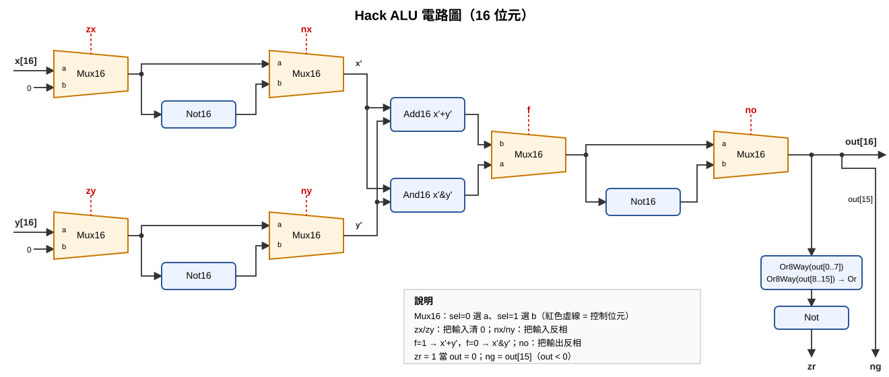

# 第三週作業：第 1、2 章

| 題目 | 檔案 |
|------|------|
| 1. 第一章所有習題 | [../01](../01)（15 個 `.hdl`，皆通過官方 `.tst`，輸出見 `.out`） |
| 2. 第二章所有習題 | 本資料夾 `HalfAdder` `FullAdder` `Add16` `Inc16` `ALU`（皆通過官方 `.tst`） |
| 3. 用真值表證明迪摩根定律 | [DeMorgan.md](DeMorgan.md) |
| 4. 證明 zx=0,nx=1,zy=0,ny=0,f=1,no=1 時 out = x−y | [ALU_x-y.md](ALU_x-y.md) |
| 5. ALU 電路圖 | [ALU_circuit.svg](ALU_circuit.svg) |

