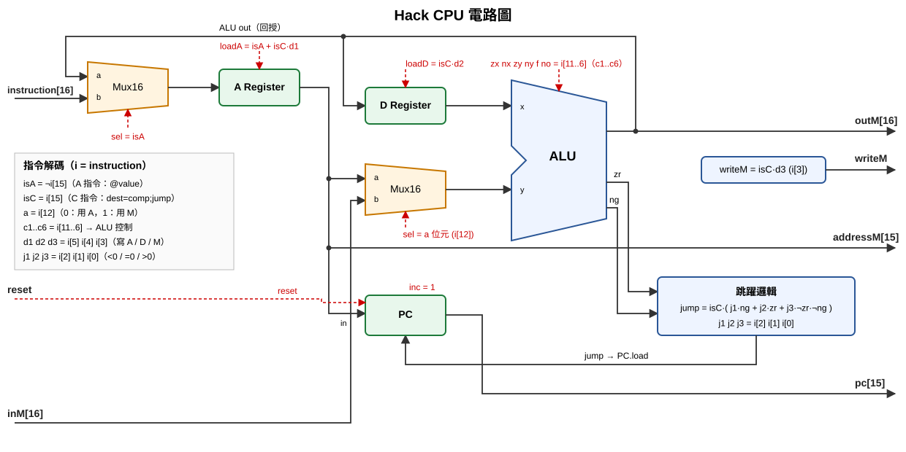

# 第六週：HackCPU 電路圖（含邏輯式與符號對應表）



> 實作檔：[CPU.hdl](CPU.hdl)（已通過 `CPU.tst`、`CPU-external.tst`）

## 1. 指令格式

```
A 指令：0 v v v v v v v v v v v v v v v        @value  → A = value
C 指令：1 1 1 a c1 c2 c3 c4 c5 c6 d1 d2 d3 j1 j2 j3   dest = comp ; jump
位元：  15 14 13 12 11 10 9 8 7 6  5  4  3  2  1  0
```

## 2. 符號對應表

| 符號 | 對應位元 / 訊號 | 意義 |
|------|----------------|------|
| i | `instruction[16]` | 目前要執行的指令 |
| isA | ¬i[15] | 1 = A 指令 |
| isC | i[15] | 1 = C 指令 |
| a | i[12] | ALU 的 y 輸入：0 用 A，1 用 M（inM） |
| c1 c2 c3 c4 c5 c6 | i[11] i[10] i[9] i[8] i[7] i[6] | 接到 ALU 的 zx nx zy ny f no |
| d1 | i[5] | 寫入 A 暫存器 |
| d2 | i[4] | 寫入 D 暫存器 |
| d3 | i[3] | 寫入 M（記憶體） |
| j1 | i[2] | ALU 輸出 < 0 時跳躍 |
| j2 | i[1] | ALU 輸出 = 0 時跳躍 |
| j3 | i[0] | ALU 輸出 > 0 時跳躍 |
| zr | ALU 輸出 | 1 = ALU 輸出為 0 |
| ng | ALU 輸出 | 1 = ALU 輸出為負 |
| A | A Register 輸出 | 位址 / 資料暫存器 |
| D | D Register 輸出 | 資料暫存器 |
| inM | 輸入 | M = RAM[A] 的值 |
| reset | 輸入 | 1 = PC 歸 0，程式重新開始 |

## 3. 邏輯式

| 輸出 / 控制線 | 邏輯式 | 說明 |
|---------------|--------|------|
| Mux1.sel | isA | A 指令時把指令本身送進 A，否則送 ALU 輸出 |
| loadA | isA + isC·d1 | A 指令一定寫 A；C 指令看 d1 |
| loadD | isC·d2 | |
| ALU.y (Mux2.sel) | a = i[12] | a=0 → A，a=1 → inM |
| ALU 控制 | zx=c1, nx=c2, zy=c3, ny=c4, f=c5, no=c6 | |
| outM | ALU 輸出 | |
| writeM | isC·d3 | 只有 C 指令才能寫記憶體（避免 A 指令誤寫） |
| addressM | A[0..14] | |
| pos | ¬zr·¬ng | ALU 輸出 > 0 |
| jump | isC·(j1·ng + j2·zr + j3·pos) | 符合任一跳躍條件就跳 |
| PC | reset ? 0 : (jump ? A : PC+1) | PC 的 load = jump、inc = 1、in = A |
| pc | PC[0..14] | 下一道指令的位址 |

> 為什麼每個控制線都要 `AND isC`？因為 A 指令的第 0~14 位元是「數值」而不是控制位元，
> 如果不擋掉，例如 `@8`（…0001000）的 i[3]=1 就會被誤當成 d3，錯誤地寫入記憶體。

## 4. 跳躍條件對照

| j1 j2 j3 | 助憶符號 | 條件 | jump 是否為 1 |
|:--------:|:--------:|------|---------------|
| 000 | (無) | 不跳 | 0 |
| 001 | JGT | out > 0 | pos |
| 010 | JEQ | out = 0 | zr |
| 011 | JGE | out ≥ 0 | zr + pos |
| 100 | JLT | out < 0 | ng |
| 101 | JNE | out ≠ 0 | ng + pos |
| 110 | JLE | out ≤ 0 | ng + zr |
| 111 | JMP | 無條件 | 1 |

> 題目要求「畫出」電路圖：可以照上圖手繪在紙上，拍照存成 `05/CPU_circuit.jpg` 一起上傳。
